# Dynamic Stackelberg Controller Execution Loop Architecture

> **Academic Interim Report Reference Diagram**  
> *Component*: Userspace Stackelberg QoS Controller (`qos_controller.py`) Execution Loop & Adaptive Polling State Machine.

---

## 1. Controller Internal Execution Flowchart

```mermaid
flowchart TD
    %% Class Styling Definitions (Excalidraw & Academic Report Ready)
    classDef telemetry fill:#FFE4E6,stroke:#9F1239,stroke-width:2px,color:#881337;
    classDef derivative fill:#FEF3C7,stroke:#B45309,stroke-width:2px,color:#78350F;
    classDef spikeState fill:#FEE2E2,stroke:#DC2626,stroke-width:2px,color:#991B1B;
    classDef baselineState fill:#DBEAFE,stroke:#2563EB,stroke-width:2px,color:#1E40AF;
    classDef calmState fill:#E0E7FF,stroke:#4F46E5,stroke-width:2px,color:#3730A3;
    classDef solver fill:#F3E8FF,stroke:#7C3AED,stroke-width:2px,color:#581C87;
    classDef push fill:#DCFCE7,stroke:#15803D,stroke-width:2px,color:#14532D;

    %% 1. Telemetry Ingestion Layer
    subgraph INGESTION ["1. Telemetry Ingestion Layer"]
        START["Loop Wakeup / Start<br>t_now = time.time()"]
        READ_MAPS["Poll Pinned BPF Maps via bpftool<br>• Dump update_counter_map (Total Hits)<br>• Inspect lock_latency_hist (Wait Latency)"]
        CALC_RATES["Compute Time & Hit Diffs<br>• Δt = t_now - t_prev<br>• ΔHits = Hits_now - Hits_prev<br>• Lock Contention Metric C = ΔHits / Δt (hits/sec)"]
    end
    class START,READ_MAPS,CALC_RATES telemetry;

    %% 2. Derivative & Adaptive Polling State Machine Layer
    subgraph ADAPTIVE ["2. Contention Derivative & Adaptive Polling State Machine"]
        DERIV["Compute Contention Derivative<br>• ΔC = C_now - C_prev<br>• Derivative dC/dt = ΔC / Δt (hits/sec²)"]
        CHECK_SPIKE{"Spike Condition?<br>dC/dt > SPIKE_THRESHOLD (5000)<br>or ΔC > 5000"}
        
        STATE_SPIKE["Spike State: Drop to 20ms (0.02s)<br>• current_interval = 0.02s<br>• calm_counter = 0"]
        
        CHECK_CALM{"Calm Condition?<br>|dC/dt| < FLAT_THRESHOLD (500)"}
        STATE_CALM_INC["Increment Calm Counter<br>• calm_counter += 1"]
        CHECK_N_CYCLES{"N Calm Cycles Reached?<br>calm_counter >= 5"}
        STATE_RELAX["Calm State: Relax to 1000ms (1.0s)<br>• current_interval = 1.0s"]
        
        STATE_DEFAULT["Default/Recovery State: Baseline 200ms<br>• current_interval = 0.2s<br>• calm_counter = 0"]
    end
    class DERIV,CHECK_SPIKE,CHECK_CALM,CHECK_N_CYCLES derivative;
    class STATE_SPIKE spikeState;
    class STATE_DEFAULT baselineState;
    class STATE_CALM_INC,STATE_RELAX calmState;

    %% 3. Game-Theoretic Stackelberg Solver Layer
    subgraph SOLVER ["3. Stackelberg Game-Theoretic Leader-Follower Solver"]
        FORMULATE["Formulate Leader-Follower Game<br>• Leader (Victims): Maximize Utility U_L(r) = B_V(r) - C(r, H)<br>• Follower (Attacker): Best Response q(r) = r"]
        TENANT_CHECK{"Tenant Type Check"}
        VICTIM_OPT["Leader / Victim Tenant (10.0.0.10..12)<br>• rate_limit = 0 (Uncapped Priority)"]
        ATTACKER_OPT["Follower / Attacker Tenant (10.0.0.20)<br>• Compute r*(H) = r_max / [ 1 + (H / H_threshold)^γ ]<br>• Parameters: r_max=50 MB/s, H_thresh=15000, γ=2.0<br>• Clamp: r_min (500 KB/s) ≤ r* ≤ r_max (50 MB/s)"]
    end
    class FORMULATE,TENANT_CHECK,VICTIM_OPT,ATTACKER_OPT solver;

    %% 4. Execution & Map Update Layer
    subgraph PUSH ["4. Execution, BPF Map Push & Telemetry Output"]
        PACK_HEX["Format 64-bit Hex Byte Structs<br>struct rate_limit_entry for Host CPU Cores"]
        PUSH_BPF["Push Limits to percpu_rate_limit_map<br>bpftool map update pinned percpu_rate_limit_map key IP value Struct"]
        LOG_JSONL["Append Record to qos_controller_log.jsonl<br>JSON: {timestamp, dt_sec, hits_per_sec, dC/dt, rate_limit, polling_interval_ms}"]
        SLEEP["Sleep for current_interval<br>time.sleep(current_interval)"]
    end
    class PACK_HEX,PUSH_BPF,LOG_JSONL,SLEEP push;

    %% Flow Connections
    START --> READ_MAPS
    READ_MAPS --> CALC_RATES
    CALC_RATES --> DERIV
    DERIV --> CHECK_SPIKE

    CHECK_SPIKE -->|Yes: Rapid Contention Spike| STATE_SPIKE
    CHECK_SPIKE -->|No| CHECK_CALM

    CHECK_CALM -->|Yes: Flat Contention| STATE_CALM_INC
    CHECK_CALM -->|No: Moderate Contention| STATE_DEFAULT

    STATE_CALM_INC --> CHECK_N_CYCLES
    CHECK_N_CYCLES -->|Yes: 5 Consecutive Cycles| STATE_RELAX
    CHECK_N_CYCLES -->|No: Warming Up| STATE_DEFAULT

    STATE_SPIKE --> FORMULATE
    STATE_RELAX --> FORMULATE
    STATE_DEFAULT --> FORMULATE

    FORMULATE --> TENANT_CHECK
    TENANT_CHECK -->|Victim IP| VICTIM_OPT
    TENANT_CHECK -->|Attacker IP| ATTACKER_OPT

    VICTIM_OPT --> PACK_HEX
    ATTACKER_OPT --> PACK_HEX

    PACK_HEX --> PUSH_BPF
    PUSH_BPF --> LOG_JSONL
    LOG_JSONL --> SLEEP
    SLEEP -.->|Next Loop Iteration| START
```

---

## 2. Step-by-Step Architectural Description

### 1. Telemetry Ingestion Layer
* **Loop Wakeup**: Starts each iteration after `time.sleep(current_interval)`.
* **Map Dumping**: Invokes `bpftool map dump pinned /sys/fs/bpf/tc/globals/update_counter_map -j` to sum cumulative per-CPU map update operations.
* **Rate Calculation**: Calculates elapsed time $\Delta t = t_{\text{now}} - t_{\text{prev}}$ and computes the instantaneous lock contention metric $C = \text{hits\_per\_sec} = \frac{\Delta \text{Hits}}{\Delta t}$.

### 2. Contention Derivative & Adaptive Polling State Machine
* **Derivative Calculation**: Computes the second-order derivative $\frac{\Delta C}{\Delta t} = \frac{C_{\text{now}} - C_{\text{prev}}}{\Delta t}$ (hits/sec$^2$).
* **State Machine Transitions**:
  * **Spike State (20ms)**: Triggered if $\frac{\Delta C}{\Delta t} > 5000$. Sleep interval drops immediately to `0.02s` for high-frequency control plane intervention.
  * **Calm State (1000ms)**: Triggered if $|\frac{\Delta C}{\Delta t}| < 500$ for 5 consecutive iterations. Sleep interval relaxes to `1.0s` to save CPU cycles.
  * **Default State (200ms)**: Active during moderate or steady traffic. Resets `calm_counter` and maintains `0.2s` baseline.

### 3. Stackelberg Game-Theoretic Solver
* **Leader Utility Optimization**: Leader (QoS Controller) selects follower rate cap $r$ to maximize expected victim throughput $B_V(r)$ minus lock contention penalty $C(r, H)$.
* **Equilibrium Formula**:
  $$r^*(H) = \frac{r_{\max}}{1 + \left(\frac{H}{H_{\text{threshold}}}\right)^\gamma}$$
  * $r_{\max} = 50\text{ MB/s}$, $r_{\min} = 500\text{ KB/s}$
  * $H_{\text{threshold}} = 15000\text{ hits/sec}$ (contention knee point)
  * $\gamma = 2.0$ (equilibrium sensitivity exponent)
* **Tenant Assignment**: Victim IPs ($10.0.0.10$..$12$) receive rate limit $0$ (uncapped priority). Attacker IP ($10.0.0.20$) receives Stackelberg equilibrium rate cap $r^*(H)$.

### 4. Execution, Map Push & Log Persistence
* **Hex Struct Formatting**: Formats 48-byte `struct rate_limit_entry` hex values (`rate_bytes_per_sec`, `max_burst_bytes`, `tokens`, etc.) duplicated across all host CPU cores.
* **Kernel Map Update**: Executes `bpftool map update pinned /sys/fs/bpf/tc/globals/percpu_rate_limit_map key IP value <hex_bytes>`.
* **Telemetry Output**: Appends JSON record to `qos_controller_log.jsonl` including `"polling_interval_ms": 20|200|1000`.
